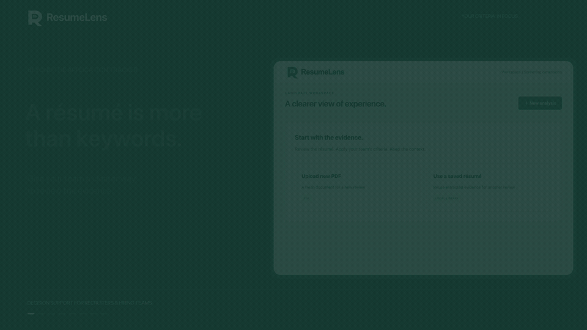
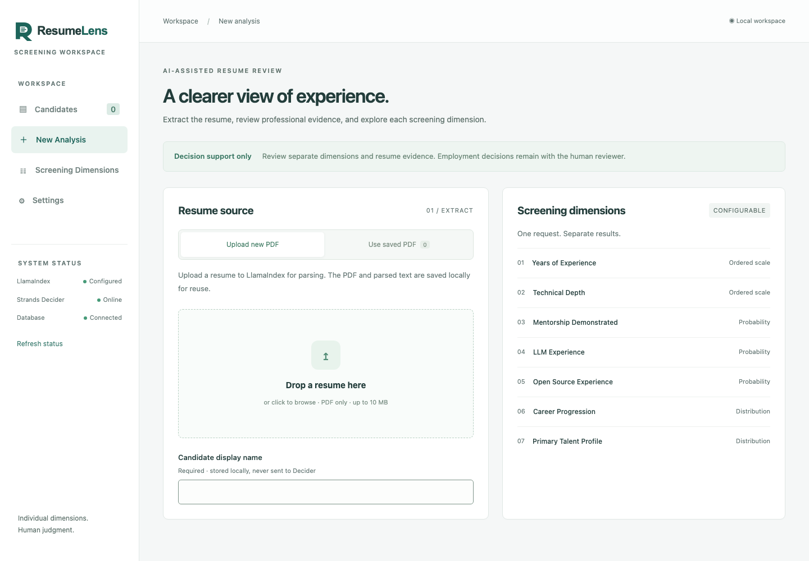

<p></p>

# ResumeLens

ResumeLens helps hiring teams review resumes against configurable criteria, with visible evidence and model outputs for human judgment.

[](demo/promo/output/resume-lens-promo-45s.mp4)

Your criteria, configurable review thresholds, and evidence-centered candidate analysis. The preview uses fictional data.

A local application for AI-assisted resume review. Separate screening dimensions, model distributions, and parsed evidence help a human reviewer interpret a resume. There is no overall candidate score, candidate ranking, or automatic employment decision.

<details>
<summary>Platform screenshot</summary>



</details>

## Prerequisites and quick start

- Node.js 22.13+ (Node 24 supported), npm, and internet access for LlamaCloud parsing.
- A LlamaCloud API key with parsing access and available credits.
- Either a supported cloud model API key (see [model connections](docs/model-providers.md)), or your existing Strands Decider server, separately managed at `http://127.0.0.1:1209`, serving `StrandsAgents/strands-decider-2B-hobson-v19`.
- SQLite requires no server. Prisma and its local engine are installed by npm.

```sh
cp .env.example .env
# Edit .env and set LLAMAINDEX_API_KEY.
npm install
npx prisma migrate dev
npm run check:decider
npm run dev
```

Open [http://127.0.0.1:5173](http://127.0.0.1:5173). Express listens on port 3000. Vite proxies `/api` to Express. If changing `PORT`, also change the proxy target in `client/vite.config.ts`.

The install hook generates Prisma Client and creates an empty `prisma/dev.db` only if absent. It never overwrites an existing database. The committed initial migration creates the tables. `.env`, database files, and uploaded resumes are excluded from version control.

## Analysis model selection

Choose Local Strands Decider, OpenAI Decisions, Gemini, Claude, or Groq in **Settings → Analysis models**. Administrators can manage multiple model connections, keys and provider parameters. Set `ADMIN_API_TOKEN` in `.env` to unlock management; cloud keys can be stored through Settings or supplied through environment variables. Local Decider stays the default. Queued analyses retain their chosen model and parameter snapshot. See [setup, official API references and processing details](docs/model-providers.md).

## LlamaIndex configuration

The integration uses the official LlamaParse v2 HTTP API, verified against:

- [Upload file](https://developers.llamaindex.ai/reference/resources/files/methods/create/): multipart `POST /api/v1/beta/files`, `purpose=parse`, PDF file. Returns `id`.
- [Create parse job](https://developers.llamaindex.ai/reference/resources/parsing/methods/create/): JSON `POST /api/v2/parse` with `file_id`, `tier=agentic`, `version=latest`.
- [Get parse job](https://developers.llamaindex.ai/reference/resources/parsing/methods/get/): `GET /api/v2/parse/{id}?expand=markdown`. Reads `job.status` and `markdown.pages[].markdown`. Failed pages cause an error rather than an incomplete screening.
- [Delete file](https://developers.llamaindex.ai/reference/resources/files/methods/delete/) and [delete parse job](https://developers.llamaindex.ai/reference/resources/parsing/methods/delete/): best-effort cleanup after completion or failure.

Set `LLAMAINDEX_API_KEY` server-side and `LLAMAINDEX_API_URL=https://api.cloud.llamaindex.ai` (or the official regional host). The base URL does not include `/api`. HTTPS is required and redirects are rejected. Optional project/organization IDs are sent as documented query parameters. No extractor ID is needed: this application parses rather than running the separate Extract API.

LlamaIndex status “Configured” checks required environment values; it is not an authenticated live connectivity check. Actual credential, quota, and parsing errors appear when uploading. Parsing can incur LlamaCloud charges. The full PDF is sent to this explicitly configured provider. Remote cleanup can fail, and provider retention policies still apply.

## Decider lifecycle

Start or check your existing Decider through your established external process manager before analysis. This application never installs, launches, stops, or loads Decider. Keep exactly one model process, bound to localhost. The Node client only calls `GET /health` and `POST /v1/systemone`.

### Start the existing environment on this Mac

In a separate macOS Terminal (zsh/bash), use the existing installation:

```sh
cd /Users/molartep/Developer/strands-decider
source .venv/bin/activate
strands-decider serve StrandsAgents/strands-decider-2B-hobson-v19 --host 127.0.0.1 --port 1209
```

Alternatively, skip activation and invoke the environment's executable directly:

```sh
cd /Users/molartep/Developer/strands-decider
./.venv/bin/strands-decider serve StrandsAgents/strands-decider-2B-hobson-v19 --host 127.0.0.1 --port 1209
```

Use only one of these startup methods. Keep the terminal open while using the app and wait for the model to finish loading. The verified installation selects `mps` automatically for the Mac GPU. This path is specific to the current Mac; adjust it on another machine.

From a second terminal, verify readiness:

```sh
curl --fail http://127.0.0.1:1209/health
```

A ready server returns `"status":"ok"`. The application's `.env` should contain `STRANDS_DECIDER_URL=http://127.0.0.1:1209`. Click **Refresh status** in the app after startup. If port 1209 is already occupied, check the existing server's health instead of starting another model process.

For PowerShell on macOS, replace the activation line with `./.venv/bin/Activate.ps1`; the `strands-decider serve` command is the same.

From the Node application folder, you can also check readiness with:

```sh
npm run check:decider
```

The script checks health before any real analysis. The API also checks health immediately before sending a request. `STRANDS_DECIDER_URL` accepts only `http://127.0.0.1:<port>` so resumes cannot be forwarded to a remote Decider host.

The request/response shapes are based on the official [Decider schema](https://github.com/strands-labs/strands-decider/blob/main/src/strands_decider/schema.py) and [server](https://github.com/strands-labs/strands-decider/blob/main/src/strands_decider/server.py). All dimensions are sent in one request. NOUL retains `noul` as P(true); CHOICE retains `choice`, `probabilities`, `confidence`; SCORE retains expected `score`, ordered `legend`, `probabilities`, and `confidence`. Raw output, usage and latency are saved without thresholding or explanation generation.

`DECIDER_TIMEOUT_MS` defaults to 120 seconds. An HTTP timeout does not cancel inference in the external process; wait before retrying. The SQLite queue serializes provider operations across workers sharing its database. The server has a finite context window (4096 tokens in the verified local health response). Its default behavior can truncate long state or questions. Keep reviewed evidence concise and preserve relevant professional details. For stronger guarantees, configure strict-window behavior through your external Decider management; the app does not change its launch flags. The UI exposes raw usage but cannot prove that no truncation occurred.

## Workflow and product boundary

1. Choose/drop a single PDF. Filename and size appear immediately. The backend validates extension, MIME type, magic header, non-empty content, and a 10 MB limit.
2. LlamaIndex extracts the resume into markdown. After successful parsing, the PDF and extracted text are saved locally, and the upload buffer is released. New Analysis offers **Upload new PDF** or **Use saved PDF**. Selecting a saved PDF loads its extraction without calling LlamaIndex again. Review confirmation is required for every new analysis.
3. Review the extracted text and edit **professional evidence** before clicking **Analyze Candidate**. This deliberate review step implements the demographic boundary instead of forwarding the full resume blindly. Suggestions start with the full parsed resume, removing an opening name/contact block when contact markers identify it, and complete sections labeled as personal/contact information or sensitive personal details. Markdown heading levels determine section boundaries; recognized plain-text headings also act as boundaries. Other content, including unfamiliar professional sections and project links, is preserved. This is not reliable automatic de-identification: inline personal disclosures, unusual headings, and locations can remain and must be reviewed. Saved PDFs also generate fresh suggestions from their full stored extraction when reused; historical analyses are unchanged.
4. Remove names, contacts, photos, addresses, age, nationality and all sensitive personal disclosures. Keep professional dates, experience, project descriptions, technologies, education, certifications and contributions. Confirm the review checkbox. Explicit sensitive-field detection is a backstop, not a guarantee. Developer configuration and reviewer input are trusted and must respect the boundary.
5. Decider evaluates all configured questions together. The candidate and analysis are saved atomically in SQLite after success.
6. Explore individual distributions and source evidence. Each dimension says “Review resume evidence”; there is no fabricated reason or exact decision-to-evidence attribution.
7. Use Candidates to reopen history. “Analyze another resume” on a candidate adds an analysis to that specific record. People are never automatically merged using filenames or inferred identity.

The required display name is entered by the reviewer and stored locally; it is never sent to Decider. Email and phone fields exist in the schema but are not extracted or populated in this version. The unmodified parsed text is retained locally for auditing extraction, along with the exact reviewed evidence sent to Decider. Do not use protected or sensitive attributes as criteria. The built-in configuration guard blocks common prohibited screening terms, but it cannot certify arbitrary configuration or text.

## Screening configuration

Edit `config/screening.config.ts` and restart the server (development watch restarts automatically). Add/remove internal IDs or edit instructions/criteria without changing service code. `shared/types.ts` defines the discriminated configuration types.

Each dimension has `label`, numeric `order`, `type`, and `instructions` (string or structured object). CHOICE has 2–255 named criteria (subject to your model's own limits); SCORE has 2–10 ordered string levels; NOUL accepts optional `true`/`false` descriptions. Optional `categoryLabels` changes UI labels separately from internal option IDs. No NOUL thresholds are configured; probabilities remain probabilities.

`{{CURRENT_DATE}}` is replaced recursively server-side immediately before submission, using `APP_TIMEZONE` (default America/New_York). Configuration validation fails safely for malformed schemas and prohibited criteria. Every successful analysis stores the **resolved** configuration, labels and ordering. Historical displays use their snapshot, not today's configuration. Candidate-list talent profile is an optional view of the `primary_talent_profile` dimension; removing it results in a dash.

Expected SCORE values are indices in the ordered rubric, **not literal years**. The UI shows all criteria and distributions. CHOICE confidence differs from the highest category probability. NOUL has no separate confidence field in the API. Results are claims about resume evidence, not verified capabilities; absence of evidence may reflect omissions in a resume.

## Persistence and architecture

```text
client/                   React dashboard and Vite
config/screening.config.ts Developer-controlled screening dimensions
shared/types.ts           Shared configuration and presentation contracts
server/routes/api.ts      Upload, review-draft, analysis, history and health routes
server/services/          Isolated LlamaIndex and Decider clients, normalization, validation
server/repositories/      Prisma access and transactional persistence
prisma/schema.prisma      Candidate -> many ResumeAnalysis records
prisma/migrations/        Initial SQLite migration
scripts/                  Decider health check and safe SQLite file preparation
tests/                    Unit, mocked application, and real SQLite persistence tests
```

Pipeline: PDF → LlamaParse → normalization → professional-evidence review → single Decider request → transactional SQLite save → dashboard.

`DATABASE_URL="file:./dev.db"` is relative to `prisma/schema.prisma`, so data lives at `prisma/dev.db`. UUID primary keys identify candidates, analyses and parsed resume documents. The `ResumeDocument` table stores each filename, PDF key, parsed text and parser metadata independently of screening results. Analyses store parsed text, reviewed evidence, raw screening JSON, resolved config JSON, parser job/page metadata, timestamp, Decider latency, original filename and the saved PDF key. API keys are never stored. Repository factories encapsulate Prisma queries. A failed analysis produces no partial candidate/analysis record; its successfully parsed resume remains reusable. Saved PDFs from earlier analyses are added to the document library by the migration. Selecting an assigned PDF pre-fills its candidate display name and adds the next analysis to that candidate’s history; unassigned PDFs require a display name. Every analysis uses current screening settings and preserves a fresh configuration snapshot.

Review drafts persist in the queue database for 20 minutes by default (at most 10 pending drafts/uploads). Restart preserves unexpired review tokens. Successfully completed analysis jobs release their drafts. Reusing a saved PDF creates a fresh review token. PDFs are briefly staged in `storage/resumes/.drafts/` while the parsed document is saved. Abandoned staging files are cleaned after one hour. Successfully parsed PDFs are retained in `storage/resumes/`, even before their first analysis, with UUID filenames and restrictive file permissions. The Resume evidence section renders the original PDF locally using [Mozilla PDF.js](https://mozilla.github.io/pdf.js/examples/), with page controls and open/download links. The worker and library are bundled with the app; PDFs are never sent to a document viewer service. Only one page is rendered at a time, with bounded canvas dimensions to limit memory use. Each historical analysis references its original saved PDF. Reusing a PDF shares the same local file without extra copies. Older analyses show a fallback message because their original PDFs were not saved. Back up `prisma/dev.db`, `storage/jobs.sqlite` and `storage/resumes/` together, using SQLite-aware backups or stopping the app first (the queue uses WAL). The storage folder is excluded from version control; files are served only through an analysis-ID API route. The app has no authentication and binds only to `127.0.0.1`. Cross-origin writes are rejected, API responses use `no-store`, filenames are sanitized, React displays text without interpreting resume HTML, and errors never include full resumes or credentials. SQLite records are local and unencrypted; control access to the workspace and avoid retaining real candidate data unnecessarily.

## API

| Method | Route | Purpose |
| --- | --- | --- |
| GET | `/api/health` | Parser configuration, Decider and database status |
| GET | `/api/config` | Validated dimensions, no secrets |
| GET | `/api/candidates` | Candidates in latest-update order (not a merit ranking) |
| GET | `/api/candidates/:id` | Candidate metadata |
| GET | `/api/candidates/:id/analyses` | Full analysis history with original snapshots |
| GET | `/api/resumes` | Previously parsed PDFs with filename, saved date and associated candidate, when available |
| POST | `/api/resumes/:id/reuse` | Create a fresh review draft from saved extraction; no parser request |
| GET | `/api/analyses/:id/resume` | Original PDF, inline by default; `?download=1` downloads it |
| POST | `/api/resumes/parse` | Multipart `resume` PDF; returns HTTP 202 and a queued parse job. Optional `Idempotency-Key` deduplicates resubmissions |
| POST | `/api/resumes/analyze` | JSON `{token,evidence,reviewed:true,name,candidateId?}`; returns HTTP 202 and an analysis job, deduplicated by review token |
| GET | `/api/jobs` | Most recent 50 jobs, including persisted status, progress and results |
| GET | `/api/jobs/:id` | Job status, stage message, percentage, attempts, error and completed result |
| POST | `/api/jobs/:id/retry` | Requeue a failed job after its cooldown; HTTP 202 |

The production server uses a SQLite-backed queue at `storage/jobs.sqlite` (Node.js 22.13+ with built-in `node:sqlite`; no extra service). Jobs follow `queued → processing → completed/failed`. Requests return immediately after durable enqueue; poll the job URL in the `Location` header. Completed parse results contain the review token, parsed text and suggested evidence; completed analysis results contain candidate, parsedResume, screening, analysis and metadata. The UI displays stage percentages and reconnects to its last job after reload using a locally saved job ID.

A worker claims one job at a time using a SQLite transaction and renews a two-minute lease every 20 seconds. Expired processing leases become failed jobs with `WORKER_INTERRUPTED`; queued work resumes on startup. Retries are explicit, limited to three total attempts, and require a one-minute cooldown. Running or completed jobs cannot be retried. Retrying keeps the original input and settings snapshot. An analysis token identifies one immutable submission; use a fresh saved-resume review token to submit different evidence. Provider responses are checkpointed before saving, and resume/analysis saves use stable job IDs to prevent duplicate local records after a crash. External provider requests can repeat if a crash occurs before their response is checkpointed; exactly-once external execution is not guaranteed.

Job inputs, checkpoints, results and review drafts are local sensitive records. The queue erases input payloads and checkpoints after completion, while retaining status and results. Failed jobs retain their input for retry. Like the application database, the queue is unencrypted. Queue tables initialize automatically; existing Prisma migrations are unchanged. Embedded callers that omit the optional jobs dependency retain the original synchronous routes.

The two-step API deliberately separates parsing and reviewed screening. A draft token is required; callers cannot submit an arbitrary filename and claim it was parsed. Review is required even if calling the API directly. Errors have `{error:{code,message}}`. Offline services, invalid PDF, size limits, malformed config, empty/partial parse, timeout, invalid model output and database failures are handled. Server logs retain technical categories/statuses rather than resume contents.

## Development and validation

```sh
npm test                 # mocks external services; actual temporary SQLite DB for persistence
npm run build            # TypeScript, Vite client, bundled Express entry
npm start                # production build on http://127.0.0.1:3000
npm run prisma:migrate
npm run prisma:studio
```

Tests cover config validation, dynamic requests, date/timezone substitution, NOUL/CHOICE/SCORE validation, raw output preservation, parser contract/cleanup, review requirements, file validation, cross-origin writes, offline/timeout handling, candidate persistence, configuration history and atomic rollback. Test databases are temporary and removed afterward. No automated test sends a real resume externally or starts another model process.

Assumptions: LlamaCloud account access is supplied by the developer; its `latest` parser version may change. The Decider process is already managed externally. Human-reviewed text is required because heuristic redaction cannot enforce arbitrary personal-information removal. No authentication, containers, cloud deployment or extra services are included. The queue runs inside the API process.

## Settings tab

Use **Settings** in the sidebar to edit LlamaParse tier (`fast`, `cost_effective`, `agentic`, `agentic_plus`), parser version, extraction instructions, cache bypass, parsing timeout and polling interval. Fast parsing is rule-based, so custom instructions are omitted for that tier. Dated versions must be supported by the chosen tier; unsupported combinations are reported by LlamaIndex when parsing.

Settings also includes Decider analysis/health timeouts, PDF size limits (1–20 MB), parsed draft expiry (1–60 minutes), pending draft limits (1–20), the date-resolution timezone, while the separate Screening Dimensions tab configures questions, criteria, labels, ordering and review thresholds. Click **Save settings** to apply changes. Saves are validated and atomic; invalid input leaves the previous settings intact. Jobs snapshot settings and resolved screening configuration when accepted, so settings changes apply to future jobs. Settings cannot be saved while a synchronous saved-resume operation is underway. Existing drafts keep their original expiry, and historical analyses retain their screening snapshot and parser metadata.

Settings are stored locally in `config/runtime.settings.json`, excluded from version control, with no API keys. Before the first save, defaults come from `config/screening.config.ts` and the existing timeout/timezone environment variables. After a save, the local settings file controls these runtime parameters. Editing the default screening config file then affects only workspaces without saved overrides; edit saved dimensions through Screening Dimensions. Restarting the app preserves saved settings. To restore developer defaults, move the local settings file aside and reload Settings.

Service URLs, API credentials, project/organization IDs, backend port and database location remain in `.env`. Their configuration status is shown read-only in Settings, and the API key is never returned. Changing `.env` requires restarting Node. Decider model/process settings remain under your external process manager; Settings does not launch or modify the model server. Fixed source-only parsing instructions and the human evidence review requirement remain in place.

`GET /api/settings` returns current runtime settings and sanitized environment status. `PUT /api/settings` validates and saves the full runtime settings object. There is no authentication; keep the application bound to localhost.

## Screening Dimensions and manual review thresholds

**Screening Dimensions** provides a form editor for display labels, question types, instructions, optional NOUL descriptions, choice categories and labels, and score levels. Internal dimension IDs are generated from display labels: lowercase, remove special characters, and replace spaces with underscores. Collisions receive numeric suffixes. Drag dimensions to change their display order; drag score cards to rearrange levels. Arrow buttons provide a keyboard-accessible alternative. A small grey advanced control at the end of each dimension expands the JSON editor; IDs and display order are calculated automatically. Changes remain drafts until **Save dimensions**. The dedicated `PUT /api/config` route validates dimensions and preserves unrelated runtime settings. Renaming a label changes its ID for future analyses; saved analyses retain their original snapshots.

Each dimension can enable its own manual-review threshold. Select a metric, below/above comparison, and threshold. NOUL supports Yes probability. CHOICE supports highest category probability, a specific category probability, or model confidence. SCORE supports expected level index or confidence. Probability/confidence controls use percentages; score controls use the rubric's zero-based index. Only values strictly below/above are flagged, not equality. Thresholds start disabled until explicitly configured; no employment criteria or cutoffs are assumed.

Candidate analysis cards show a red **Manual review needed** warning when the applicable threshold is violated. The warning shows the actual value, threshold and source as application interpretation. It never changes the raw model output, hides distributions, assigns an overall score or makes an employment decision. Threshold configuration is saved with every new analysis and is never sent to Decider.

For previously saved analyses, current thresholds apply immediately only when internal ID, type, instructions and criteria match the saved model-facing definition (with CURRENT_DATE resolution allowed). Label/order changes do not change the rubric. Otherwise, the threshold stored in that analysis is used. Cards identify the source. Older analyses without a compatible current rule or saved threshold have no automatic flag. Editing questions or criteria therefore cannot silently reinterpret a historical result against a different rubric.

## Synthetic evaluation and demo

Run `npm run evaluate` for offline synthetic fixture checks. Explicit, budget-bounded live runs use every enabled production provider adapter. Reports snapshot fictional evidence, rubric and model settings, distinguish native distributions from generated estimates, and measure semantic bounds, consistency, drift and latency. See [evaluation methodology and live command](evaluations/README.md). Live outputs are private local artifacts excluded from Git and CI.

Years of Experience uses its own deterministic calculation type and is excluded from model requests. Overlapping calendar months count once; incomplete dates always require review. January 2021–December 2024 is 48 months (4 years), with no model score or probability distribution. Manual review thresholds use documented years. Historical SCORE analyses retain their original rubrics and indices.

The silent [one-minute demo](demo/output/resume-lens-demo.mp4) shows the real application with fictional resumes and explicitly simulated provider responses. See [recording and reproduction notes](demo/README.md). The demo uses a separate temporary database and never reads candidate records from the normal workspace.

The separate [45-second promotional video](demo/promo/output/resume-lens-promo-45s.mp4) highlights team-defined criteria, fast decision models, dimension-level scoring, and source evidence. It uses a stock neural voice and fictional platform data. See [promo production notes](demo/promo/README.md).

## Brand identity

The complete [brand manual](docs/brand/BRAND.md), [supplied brand kit](docs/brand/resumelens-brand-kit.zip), and original assets are preserved under `docs/brand/`. The platform and both videos use the R-Lens logo, ResumeLens wordmark, and shared semantic palette. See [implementation and verification](docs/brand/IMPLEMENTATION.md).

## Candidate workspace and Analysis History

The candidate workspace shows the **Screening Template** used for each candidate's latest saved analysis, including its original revision. Historical records without template provenance display **Template not recorded** rather than inferring a template from current settings.

Open **Analysis History** in the sidebar to browse every saved analysis across candidates, newest first. Each row shows the analysis date, candidate, screening template and revision, evaluation model, original resume filename and a **View analysis** link. Paging keeps the complete history accessible without loading resume text into the list. Multiple evaluations of one candidate remain separate rows. Template edits and deletion do not change the provenance shown for older analyses.

Links use `#analyses/<analysis-id>` and open that exact saved result, including after reload or in a new browser tab. The candidate's other saved results remain available from the detail page's history selector. `#analysis-history` opens the global history page directly. Viewing history or a saved result never runs inference.

`GET /api/analyses?page=1&pageSize=25` returns `{ items, total, page, pageSize }` with metadata only. Page sizes from 1 to 100 are supported. `GET /api/analyses/:id` returns the specific saved analysis and its candidate. Existing candidate-specific history and original-PDF endpoints are unchanged. No database migration is required for this view.

## Screening Templates

Open **Screening Templates** in the sidebar to create, inspect, search, edit, duplicate or delete reusable screening criteria. Click a template title to edit its name, description, dimensions, order, instructions, rubrics and review thresholds. **Cancel** leaves the editor without saving; **Save template** persists the changes. Starter templates cover General Candidate Screening, Software Engineer, Data Engineer, Customer Success Manager and Operations Manager, each with a description of the criteria it includes. Customize criteria to the specific role before use.

Every **New Analysis** requires an existing saved template. Select one from the **Screening template** dropdown; there is no custom-configuration option. Uploaded resumes and reviewed professional evidence stay intact when switching templates. Edit screening dimensions on the Screening Templates page. A template updated in another tab must be reloaded before analysis; a deleted template must be replaced with another selection. The API enforces the selected identity, revision and saved dimensions before accepting new work.

Choose the model separately for each analysis. **Evaluation model** previews the provider and model; its pencil button reveals the connection selector and supported model parameters. Changing models never changes the screening template or its revision. Connection URLs and credentials remain in **Settings**, linked from the model section. Screening dates use the application's timezone setting, which is hidden from template and analysis editors.

### Example criteria and review thresholds

Every example includes **CHOICE**, **NOUL**, **SCORE**, and deterministic **Years of Experience** dimensions. Concrete actions and context matter more than titles, employer or school prestige, writing style, or tenure. Relevant project, volunteer and transferable experience count for model-evaluated dimensions; qualitative outcomes are valid without numerical metrics. Missing resume detail calls for structured follow-up, not a conclusion about capability.

| Type | Example purpose | Human-review behavior |
|---|---|---|
| CHOICE | Distinguish Clear evidence, Partial evidence and Not documented | Core dimensions flag P(clear evidence) below 65% |
| NOUL | A focused yes/no check, such as testing practices, data validation or stakeholder coordination | Flag P(yes) below 65% |
| SCORE | Depth of problem solving, implementation, reliability or customer/operational delivery | Four ordered evidence levels (0–3), flag expected level index below 2 |
| Years of Experience | Total documented employment duration, calculated locally with overlapping months counted once | Missing, year-only or ambiguous dates always need review; no universal minimum years is assumed |

The SCORE levels progress from **0: no documented example**, through **1: partial evidence** and **2: a concrete example**, to **3: the richer evidence specified for that dimension**. Each rubric defines its own role-relevant examples. The score is a dimension-level evidence index, not employment duration or aggregate suitability. Equality at a configured threshold does not flag.

These are editable evidence-triage settings, not validated qualification cutoffs or calibrated probabilities of job performance. Review thresholds against representative examples and specific job requirements before operational use. Flags preserve all model distributions and never make an employment decision. General learning/adaptation, software design scope, distributed processing, and customer commercial expansion remain contextual CHOICE dimensions with no automatic flag. Add a documented-years threshold only when a specific role has a justified experience requirement. The built-in duration calculation measures total employment, not years in a particular specialty. No universal portfolio sizes, quotas, certifications or vendor stack are imposed.

The examples focus on job-related tasks and observable evidence, following [OPM guidance on selecting competencies through job analysis](https://www.opm.gov/frequently-asked-questions/assessment-policy-faq/structured-interviews/how-do-i-select-the-competencies-or-content-areas-i-want-to-assess-with-the-structured-interview/). Their specific dimensions and numerical review setting are product examples, not validated assessments. Use structured interviews or suitable work samples to clarify incomplete evidence.

### Configuration, revisions and snapshots

Templates contain dimension IDs, labels, ordering, types, text or structured instructions, NOUL/CHOICE/SCORE criteria, category labels, legacy experience-month mappings and manual-review metrics/operators/values/categories. They exclude models, model parameters, timezone, parser options, infrastructure settings, credentials, candidate data, results and job state. The shared dimension validator remains the source of truth for both saved templates and execution.

Templates are global to the installation and persist as validated JSON through Prisma and SQLite. Names are trimmed, limited to 120 characters and unique after Unicode normalization and case-insensitive normalization; descriptions allow 2,000 characters. Each changed save advances the revision; unchanged saves leave it intact. Stale updates return a conflict with reload/save-as-new guidance. Template operations never run inference.

Accepted analyses retain complete `executionConfigurationSnapshot` records containing the selected template's dimensions, resolved date placeholders, the independently selected model parameters, the effective application timezone and template provenance. Historical results and thresholds use their saved settings. Queued work and retries keep their accepted snapshots across restarts, including after template edits or deletion. Historical snapshots from the original template schema retain their original model and timezone fields unchanged. Provider outputs can still vary when underlying models or infrastructure change.

### Migrations and existing installations

Stop the app, retain your normal database backup, then run:

```sh
npx prisma migrate deploy
npx prisma generate
npm run build
npm start
```

The original `20261125000000_screening_templates` migration adds the template and initialization tables and nullable analysis snapshot column. Startup initializes starter examples once in a transaction. Existing installations receive Customer Success Manager and Operations Manager under a separate persistent initialization marker. Later starts never overwrite modifications or restore deleted starters.

`20261125010000_template_dimensions_only` upgrades saved templates from schema 1 to schema 2, removing their model and timezone fields and advancing their revisions. It replaces the original boilerplate descriptions for the three named starters while preserving customized descriptions. Existing dimensions, identifiers, creation dates, candidate evaluations, analysis snapshots and queue payloads are preserved. Model connections remain globally configured and supply the analysis's initial model selection; no removed template model is automatically applied to future analyses.

Development installations can use `npm run prisma:migrate`. Legacy analyses without complete snapshots retain their available historical information; missing settings are never fabricated. New submissions require a saved template. Previously accepted jobs continue using their original execution settings.

### API and validation

- `GET /api/screening-configuration`: current dimension defaults plus the active analysis model and application timezone.
- `GET /api/screening-templates` and `GET /api/screening-templates/:id`: library and complete saved criteria.
- `POST /api/screening-templates`: create with `name`, optional `description`, `configuration: { dimensions }`, and `configurationSchemaVersion: 2`.
- `PATCH /api/screening-templates/:id`: complete replacement with `expectedRevision` for optimistic concurrency.
- `POST /api/screening-templates/:id/duplicate`: independent copy with a new `name` and optional `description`.
- `DELETE /api/screening-templates/:id`: delete only the template.
- `POST /api/resumes/analyze`: submit `configuration` containing the selected template dimensions and analysis model parameters, together with `templateProvenance`. The server requires a current saved template, rejects modified dimensions and resolves the effective timezone from application settings.

Unsupported template schema versions and unknown fields are rejected rather than silently discarded. No version-history browser, batch API, aggregate candidate scoring, ranking or automated employment decision is introduced. Hosted queued work still requires its original connection's credentials.

Run `npm test` for temporary-SQLite lifecycle, migration, validation, model separation, required selection, snapshot, retry, restart and view regressions. Type checking runs as part of `npm run build`; no separate lint command is configured.
